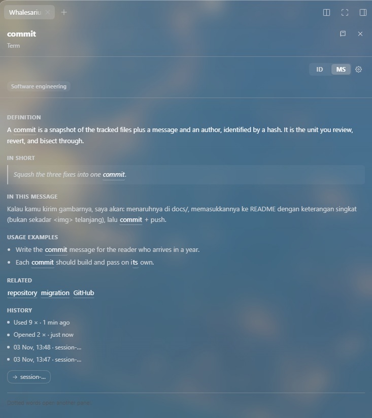
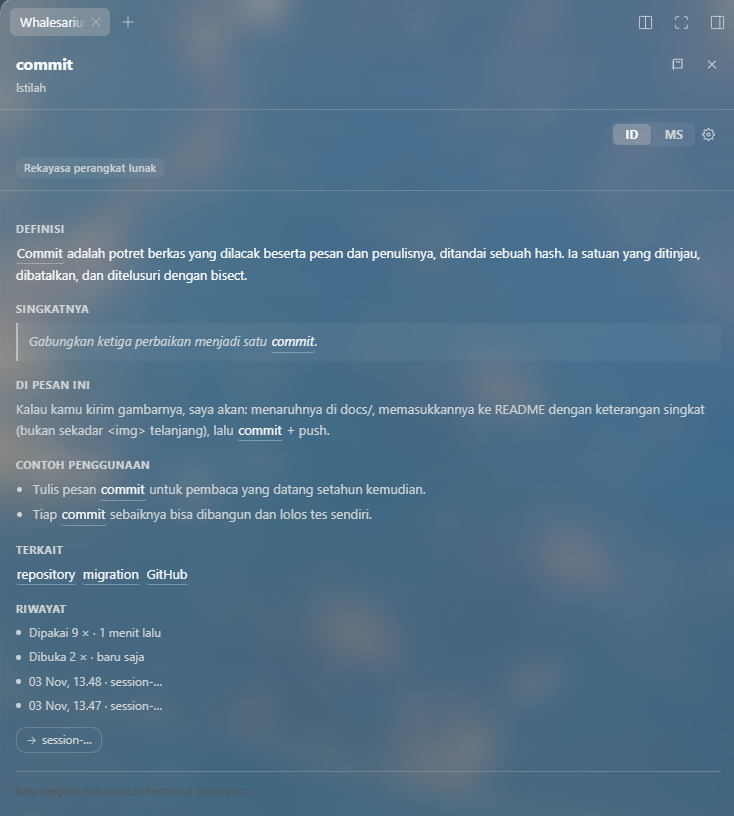
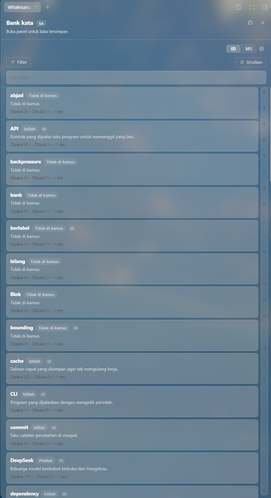
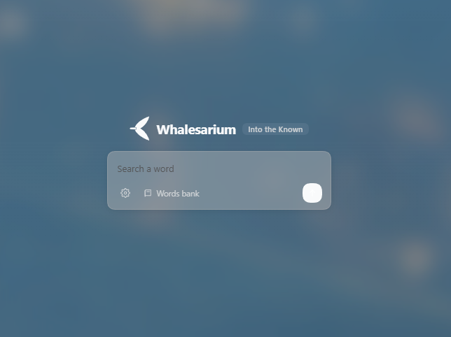

# Whalesarium

> Marks the words you had to look up, then remembers them.

A [DeepSeek Harness](https://github.com/deepseek-ai) plugin that highlights complex terms and
product names inside assistant messages, explains them in a right-sidebar pane, and keeps a
personal word bank. The mascot is a bowhead whale, the mammal that lives longest — around two
hundred years.


## What it does

- **Highlights** the shipped glossary — 44 entries (33 technical terms and 11 product names, 112
  surface forms once aliases are counted) — inline in chat prose, leaving the surrounding Markdown
  untouched.
- **Hover** a highlighted word for a short card, **click** it for the full definition in the
  sidebar pane: senses, an example, where you met it, and related terms.
- **Right-click any selection** → `What dis?` explains a word that is not in the glossary.
- **Word bank** of every word you open, glossary entry or not: use and open counts, per-session
  history, search, filter (terms, products, undefined, opened, unopened), sort (name, date), and an
  A–Z index whose letters jump to the matching word.
- **Two-language switch**: pick any two of twenty languages in Settings. The definition is fetched
  per language, so one word can hold an English and an Indonesian explanation at once.
- **Smart switching**: highlighting an English term opens the English pane, Indonesian prose opens
  the Indonesian one.

## A look at it

Clicking a highlighted word opens the pane. One word keeps a definition **per language**, so
switching between the two languages in the switch is instant once each has been fetched:

| English | Indonesian |
| --- | --- |
|  |  |

The word bank keeps every word you opened — usage and open counts, per-session history, its own
filter and sort, a language badge on each card, and an A–Z index down the right edge that jumps to
the letter you click:

<p></p>

And the dock before you pick a word, with the settings gear and the bank shortcut:

<p></p>

## Where definitions come from

The matching Wiktionary edition is asked first — free, fast, and credited in the pane (CC BY-SA
3.0). The session model is used only when the dictionary misses.

Measured against the live editions:

| Dictionary hit | Falls back to the model |
| --- | --- |
| English, Indonesian, Malay, Thai, Vietnamese, Spanish, French, German, Japanese | Chinese, Korean, Russian, Arabic, Hindi, Portuguese, Italian, Turkish, Polish, Dutch, Filipino |

Each edition marks sections and definitions its own way (`== Français ==` vs `{{-vie-}}`,
`# gloss` vs `:[1] gloss` vs `;1 gloss`), and the parser handles the three shapes it has met. An
edition that cannot be parsed is reported as a miss rather than guessed at, so the model answers
instead of the pane showing furniture like "did you mean".

## Requirements

- DeepSeek Harness with the Web carrier: the pane lives in the native right sidebar, so it needs
  that sidebar to exist.
- A model selected for the session. It is only called on a dictionary miss.

## Install (local plugin)

This package is not published to npm. The Harness loads it as a local package, so install it by
making the folder resolvable by its package name and letting its bundle patch insert itself.

1. Clone the repository somewhere stable.
2. Link it into the active profile's `node_modules` under the name in `package.json`:

   ```powershell
   # Windows, from the profile directory
   New-Item -ItemType Junction -Path "$HOME\.dsh\profiles\desktop\node_modules\@local\complex-words" `
     -Target "C:\path\to\whalesarium"
   ```

   ```bash
   # macOS / Linux
   mkdir -p ~/.dsh/profiles/desktop/node_modules/@local
   ln -s /path/to/whalesarium ~/.dsh/profiles/desktop/node_modules/@local/complex-words
   ```

3. `cordis.patch.yml` in this repository is the bundle patch; the Harness reads it through the
   `dsh.bundle.patch` field in `package.json` and adds the plugin entry on next start.
4. Restart the Harness. The sidebar gains a **Whalesarium** tab.

The display name comes from `locale/en.json` and `locale/id.json`. The package name stays
`@local/complex-words`; changing it means updating `cordis.patch.yml` and reinstalling.

## Data and privacy

Everything the bank holds stays in your browser profile:

- `dsh-complex-words:bank:v1` — words, counts, events, sessions, cached definitions
- `dsh-complex-words:lang` — the language currently shown
- `dsh-complex-words:langs:v1` — the two languages in the switch

The Host half registers two routes on the Harness web server: `POST /complex-words/define` and
`GET /complex-words/ping`. They are bound to loopback, and — like every plugin route in the
Harness — they carry no authentication of their own, so any local process could call them and
spend model tokens. Keep that in mind on a shared machine.

Requests leave your machine only to the Wiktionary edition for the language you selected, and to
your configured model provider when the dictionary misses.

## Credits

- Wiktionary, for definitions — [CC BY-SA 3.0](https://creativecommons.org/licenses/by-sa/3.0/).
- Whalesarium is an independent plugin; it is not affiliated with the DeepSeek Harness project.

## License

MIT — see [LICENSE](LICENSE).
